<div align="center">

<a href="https://yash0238.github.io/Vortex-AI/">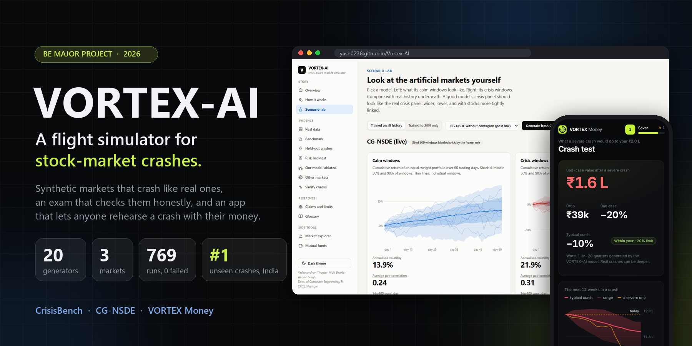</a>

### Can an AI-generated stock market crash like a real one?

**We built one that tries, an exam that checks it honestly, and an app that lets anyone rehearse a crash with
their own money before it happens.**

<br>

[](https://yash0238.github.io/Vortex-AI/)
&nbsp;
[](https://vortex-money.onrender.com)
&nbsp;
[](https://vortex-api-w555.onrender.com/api/health)

<br>


BE Major Project · Department of Computer Engineering · Fr. Conceicao Rodrigues College of Engineering, Mumbai

**Yashovardhan Thopte · Alok Shukla · Aaryan Singh**

</div>

---

## See it in action

<table>
<tr>
<td width="68%" align="center">
<a href="https://yash0238.github.io/Vortex-AI/">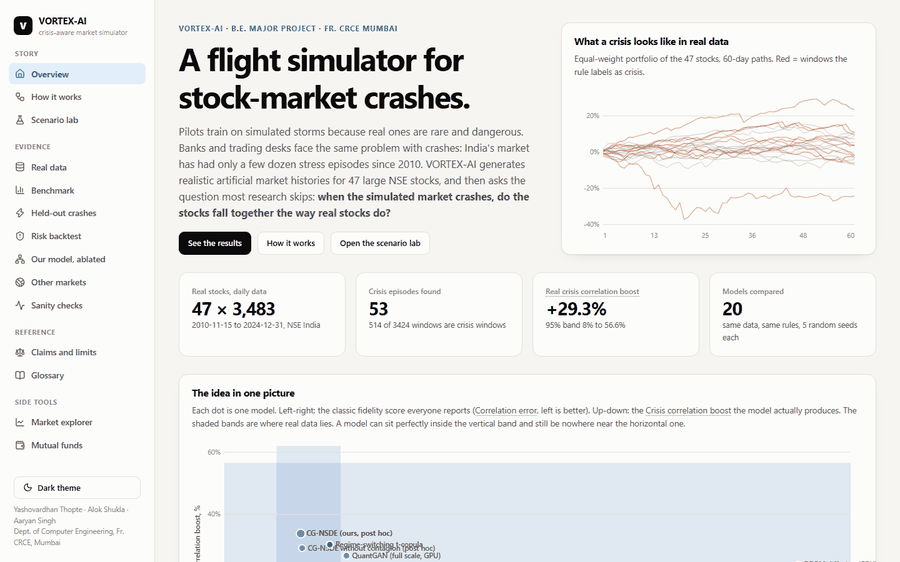</a>
<br><b>Research dashboard</b><br><sub>The benchmark, the model, every result, and live market generation from the trained model.</sub>
</td>
<td width="32%" align="center">
<a href="https://vortex-money.onrender.com">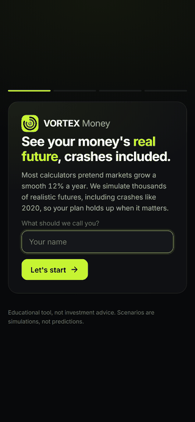</a>
<br><b>VORTEX Money</b><br><sub>Three questions, then your own crash rehearsal in rupees.</sub>
</td>
</tr>
</table>

<div align="center">

| 📉 **101%** | 🧠 **20** | 🌏 **3** | 🔁 **769** | 🥇 **#1** | 🛡️ **#1 of 18** |
| :-: | :-: | :-: | :-: | :-: | :-: |
| rise in stock correlation during the COVID crash (India) | generators put through the same exam | stock markets: India, US, Korea | runs, zero failures | on crises the models never saw (India) | generators at forecasting real daily risk |

</div>

---

## Contents

1. [The problem in one picture](#the-problem-in-one-picture)
2. [What we built](#what-we-built)
3. [Try it now](#try-it-now)
4. [CrisisBench: an honest exam for fake markets](#crisisbench-an-honest-exam-for-fake-markets)
5. [CG-NSDE: a generator where stress spreads like a contagion](#cg-nsde-a-generator-where-stress-spreads-like-a-contagion)
6. [Results](#results)
7. [What did not work (and why we publish it anyway)](#what-did-not-work-and-why-we-publish-it-anyway)
8. [VORTEX Money: the app for everyone else](#vortex-money-the-app-for-everyone-else)
9. [The research dashboard](#the-research-dashboard)
10. [Architecture and deployment](#architecture-and-deployment)
11. [Run it on your laptop](#run-it-on-your-laptop)
12. [Reproduce every number](#reproduce-every-number)
13. [Repository map](#repository-map)
14. [Limitations and responsible use](#limitations-and-responsible-use)
15. [Team, paper and licence](#team-paper-and-licence)

---

## The problem in one picture

On a normal day, Reliance and HDFC Bank move somewhat independently. In March 2020 they fell **together**, along
with almost everything else. The "safety" of a diversified portfolio vanished exactly when it was needed.

> On our Indian panel, stocks became roughly **twice as correlated** during the COVID crash
> (a 101% rise in average correlation, 95% interval 65% to 140%).

Banks, funds and researchers increasingly train and test their risk models on **synthetic** market data: artificial
price histories produced by generative AI. These generators are usually graded on whether they match the
*average* correlation between stocks. That is like testing a flight simulator only in clear weather.

**VORTEX-AI asks the question that matters: does the fake market crash like the real one?**

---

## What we built

| | Piece | In one line |
| :-: | --- | --- |
| 🧪 | **CrisisBench** | A benchmark that grades synthetic market data *during crashes*, with all rules fixed in advance and every error measured against real-world noise. |
| 🧠 | **CG-NSDE** | Our generator: a graph-conditioned latent neural stochastic differential equation in which a crash in one stock raises the risk of the stocks most connected to it. |
| 📊 | **Research dashboard** | An interactive site that walks through the benchmark, the model, every result and every failure. |
| 💸 | **VORTEX Money** | A consumer app that turns the model's crash scenarios into plain-rupee answers: *"What would a bad crash do to my ₹2 lakh?"* |
| 📄 | **IEEE paper** | *Evaluating Crisis Dependence in Synthetic Equity Returns: A Preregistered Benchmark and a Graph-Contagion Neural SDE* (`paper/`). |

The scale behind it: **20 generators**, **3 stock markets** (India, United States, Korea), **14 years** of daily
data, **769 training and evaluation runs**, **0 failed runs**, and a downstream risk test on real 2020–2024 trading days.

---

## Try it now

| What | Link | What to try |
| --- | --- | --- |
| Research dashboard | **https://yash0238.github.io/Vortex-AI/** | Open *Our model*, then the *Scenario lab*, and press **Generate fresh scenarios** to sample new markets from the trained model. |
| VORTEX Money | **https://vortex-money.onrender.com** | Answer three questions, then open **Crash test** and **Fund X-ray** (search "UTI Nifty 50"). |
| Live model API | https://vortex-api-w555.onrender.com/api/health | `POST /api/generate {"n":200,"seed":1,"fit":"full"}` returns freshly generated market windows. |

> The two servers run on a free plan and sleep after 15 minutes without visitors. The first visit after a nap takes
> about a minute; after that they respond normally. Live generation takes about 20 seconds on the free CPU.

---

## CrisisBench: an honest exam for fake markets

Most benchmarks let the model being tested influence its own grade. CrisisBench is built so that it cannot.

**1. The rules were frozen before any model was scored.** On 12 November 2026 we froze, in one protocol file
(version 1.0.0), the data, train/test splits, crisis definition, metrics, five hypotheses (H1–H5), four pass/fail
gates (G1–G4) and a rule for abandoning our own headline claim if the evidence went against it. It did, and we
followed the rule. (This is called **preregistration**, and it is common in medicine but rare in machine learning.)

**2. One crisis rule for everyone.** A 60-day window counts as a crisis if a score built from its own returns
(volatility, the share of stocks down more than 5% in five days, and near-circuit moves) is in the top 15%. The same
rule is applied to real and generated windows, and it contains no correlation term, so a model cannot pass by simply
producing high correlations.

**3. Errors in units of real noise.** Every error is divided by how much the real statistic varies when we resample
real history. A score of **1.0 means "as far off as real data is from itself"**. Below 1 is within real-world noise.

**4. Four families of tests.**

| Family | Asks | Examples |
| --- | --- | --- |
| A, single stock | Do individual stocks behave realistically? | fat tails, volatility clustering, skew |
| B, normal-day correlation | Is the average co-movement right? | correlation-matrix distance, eigenvalue spectrum |
| C, **crisis dependence** | Does co-movement rise in crashes the way it really does? | crisis correlation boost, tail co-crashes, crisis-to-calm shortfall ratio |
| D, detectability | Can a classifier tell fake from real? | gradient-boosted real-vs-fake accuracy |

**5. Unseen crises.** Models are also trained only up to 2019 and judged on the **COVID crash (2020)**, the
**2022 rate-and-war shock** and **mid-2024**, which they never saw.

**6. Does the score actually matter?** We use each generator's scenarios to forecast real daily Value-at-Risk and
Expected Shortfall from 2020 onwards, and check whether the benchmark's ranking predicts which generators forecast
risk best.

**7. Stress-testing the benchmark itself.** On simulated markets with a *known* crisis effect we check whether the
crisis statistic reads it correctly, and we inject a bad tick, random spikes and an unadjusted stock split into the
data to see whether rankings survive.

---

## CG-NSDE: a generator where stress spreads like a contagion

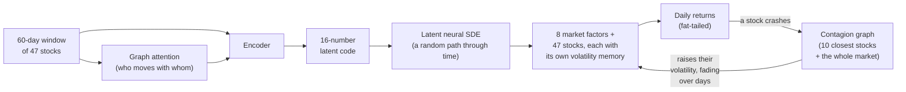

How it generates a market, in plain words:

1. **Pick a mood.** Draw calm or crisis with the frequency seen in training, then a short latent code (16 numbers)
   that summarises "what kind of 60 days these will be".
2. **Walk through time.** A neural stochastic differential equation turns that code into a smooth random path.
3. **Set the risk of every factor and stock.** Eight market-wide factors and each of the 47 stocks carry their own
   volatility memory (an EGARCH-style recursion). When the shared factors become turbulent relative to
   stock-specific noise, **correlations rise on their own**, which is the crisis effect we want.
4. **Let crashes spread.** When a stock has a tail day (below its 1% quantile), the volatility of its **10 most
   connected stocks** and of the whole market jumps and then fades over the following days. This is a
   **graph-Hawkes process**, the same family of self-exciting models used for earthquake aftershocks.
5. **Replay realistic shocks.** Daily shocks are resampled from the model's own fitted residuals (filtered
   historical simulation), so tails stay as fat as real ones.

### The design path: one design, two changes

We registered a first design before seeing any results. It failed the benchmark, we diagnosed why, and we made two
changes, measuring what each one did. Both changes are reported as **post hoc** (designed after the failure) and
were developed only on 2010–2019 data.

| Step | What changed | Crisis score, whole history | Crisis score, unseen 2020–24 |
| --- | --- | :-: | :-: |
| First design (registered) | The decoder could see each window's codes directly, and one volatility number scaled every stock. It memorised its training windows and could not make stocks move together more in a crash. | 1.22 | 1.21 |
| **Change 1** | **Removed** the shortcut: everything passes through a small 16-number bottleneck. **Added** a separate volatility memory per factor and per stock, plus replayed residuals. | 0.15 | 0.74 |
| **Change 2: final model** | **Added** crash contagion along a learned graph of the 10 nearest stocks, plus a market-wide term. | 0.16 | **0.68** |

What the model learned is itself a finding: in every training run, **stress spread to neighbouring stocks far more
than it echoed in the stock that was hit** (the self-excitation weight stayed near zero while the neighbour weight
grew more than tenfold).

Why we believed in contagion before building it: in a separate preregistered study on the Kenneth French 49 US
industry portfolios (1926–2026), a self-exciting model of daily tail events forecast 1,025 out-of-sample 20-day
blocks better than an extreme-value baseline and beat it on all 3 record crashes. It could not predict when a crash
starts, only how hard it amplifies once it has begun. That is exactly the job the contagion term does.

---

## Results

All numbers below are generated by code from the run outputs (`results/tables/`, `paper/numbers.tex`); nothing is
typed by hand. Lower scores are better.

### Unseen crises (trained to 2019, judged on 2020–2024, India)

| Rank | Generator | Crisis score |
| :-: | --- | :-: |
| 🥇 1 | **CG-NSDE (final model)** | **0.68** |
| 2 | CG-NSDE without contagion | 0.74 |
| 3 | DCC-GARCH | 0.87 |
| 4 | Asymmetric DCC (strong classical) | 0.92 |
| … | 16 more, including official Diffusion-TS (ICLR 2024) | up to 7.26 |

### Consistency across 3 markets × 2 settings (6 tests)

| Generator | Average rank on crisis dependence | Worst rank |
| --- | :-: | :-: |
| **CG-NSDE (final model)** | **2.3** | **4th** |
| Stationary bootstrap (replays real days) | 2.7 | 5th |
| CG-NSDE without contagion | 2.8 | 5th |
| Regime-switching t-copula (strong classical) | 4.5 | 8th |
| Regime Gaussian | 5.2 | 9th |
| DCC-GARCH | 6.3 | 9th |

No single model wins every test, ours included. The bootstrap is best in sample in the US and Korea, and a
regime-switching copula ties us on Korea's unseen crises. CG-NSDE is the one that is **never far from the top**.

### Real risk forecasting (VaR/ES backtest from 2020, 18 generators)

- CG-NSDE has the **lowest forecast loss of all 18 generators** (FZ0 loss at 97.5%).
- Only a GARCH-t model fitted directly on the portfolio does better, and that is a dedicated risk model rather than
  a scenario generator.
- At the 99% level its VaR was breached 19 times against 12.4 expected, so the far tail is still too optimistic.

### What makes it work (ablation, unseen crises)

| Remove… | Crisis score | Verdict |
| --- | :-: | --- |
| nothing (final model) | 0.68 ± 0.04 | |
| the whole contagion term | 0.73 | worse |
| only the spread to connected stocks | 0.75 | worse: **the gain is contagion between stocks** |
| the learned graph (use equal links) | 0.68 | same score, weaker volatility realism: *that* stress spreads matters more than exactly where |
| graph attention encoder | 0.67 | not needed |
| separate factor volatility | 0.90 | much worse |

### A warning the benchmark caught

The official **Diffusion-TS** code (a 2024 state-of-the-art generator) matches normal-day correlations reasonably
well, but fewer than **1% of its windows look like a crisis** (real data: 15%). A risk team grading it on
correlation alone would never notice. This is exactly the failure CrisisBench exists to expose.

---

## What did not work (and why we publish it anyway)

We fixed our hypotheses in advance, so we report every verdict, including the uncomfortable ones.

| Hypothesis | Verdict | What it means |
| --- | --- | --- |
| H1: correlation and crisis scores rank models differently | ❌ not supported (τ = 0.49) | In sample, the two views mostly agree, so our "abandon the headline" rule was **triggered**. |
| H2: a simple regime model matches our registered design | ✅ supported | Our first design really was weak. |
| H3: crisis scores predict risk-forecast quality better | ❌ narrowly | Crisis τ = 0.56 vs correlation τ = −0.07, but the intervals touch. |
| H4: H1 replicates in another market | ❌ not supported | Same in the US and Korea. |
| H5: one bad tick can change rankings | ✅ supported | Data cleaning is a precondition for any comparison. |

Also:

- **A confirmatory test failed.** A label-free variant looked best in India, so we predicted it would hold in the US
  and Korea. It failed in Korea, and we did not adopt it.
- **The crisis statistic has limits.** On simulated markets it reads a true 80% crisis effect as about 38%, and
  pure volatility clustering alone produces a positive reading. It is therefore an **ordinal** score: good for
  comparing, not for measuring.
- **No model reproduces COVID's intensity.** Real correlation rose about 101%; our model reaches 25% on unseen data.

What survives is narrower but solid: **correlation error alone is the least informative way to grade a generator
for risk use**, and **a contagion mechanism gives the most reliable crash behaviour across markets.**

---

## VORTEX Money: the app for everyone else

> *"See your money's real future, crashes included."*

Most people never see what a crash would do to *their* savings until it is happening, and that is when they panic
and sell. VORTEX Money lets them **rehearse it first**, using thousands of crash scenarios generated by the
research model.

<table>
<tr>
<td align="center">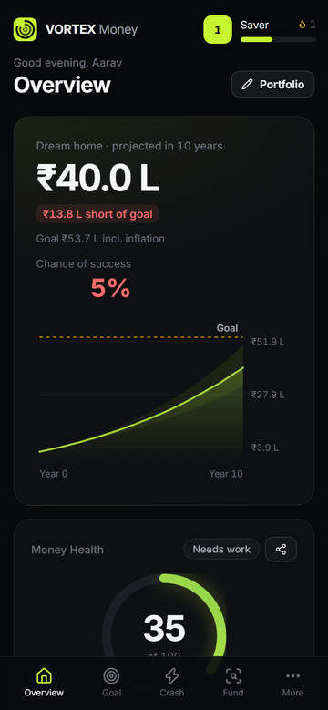<br><b>Your plan at a glance</b></td>
<td align="center">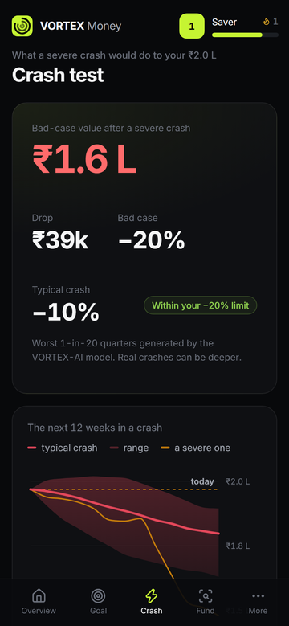<br><b>Crash test, in rupees</b></td>
<td align="center"><br><b>X-ray any mutual fund</b></td>
</tr>
</table>

<p align="center"><a href="https://vortex-money.onrender.com"><b>▶ Try it live: vortex-money.onrender.com</b></a></p>

| Screen | What it answers |
| --- | --- |
| **Overview** | Your plan, your safety score, and your next step. |
| **Goal planner** | "Will I reach ₹X by year Y?", with the odds computed through realistic crashes rather than a straight line. |
| **Crash test** | "What would a bad crash do to my money?" in rupees, with a 12-week crash path, a **crash plan** you lock in *before* panic, and the **behaviour gap**: what selling in March 2020 would have cost you. |
| **Diversification** | The "diversification that disappears" meter: how much your mix's safety shrinks when correlations jump in a crash. |
| **Fund X-ray** | Search any Indian mutual fund (live AMFI data) and see its real history, worst fall and recovery time. |
| **Retirement** | "Will my money last?", simulated through crash-and-recovery paths. |
| **Reality check** | Test a "guaranteed 30% return" tip against what markets actually do. |

Plus streaks, missions, badges, a shareable score card, phone and desktop layouts, and optional accounts with
cross-device sync. Without an account it works fully in the browser.

**Backend:** FastAPI with scrypt password hashing, signed expiring tokens, per-IP rate limits, strict CORS,
security headers and a cached proxy for fund data (`money_api/app.py`, tests in `tests/test_money_api.py`).

*VORTEX Money is an educational simulator, not investment advice.*

---

## The research dashboard

Built for the project panel: every claim on it links to the evidence behind it.

<p align="center">
  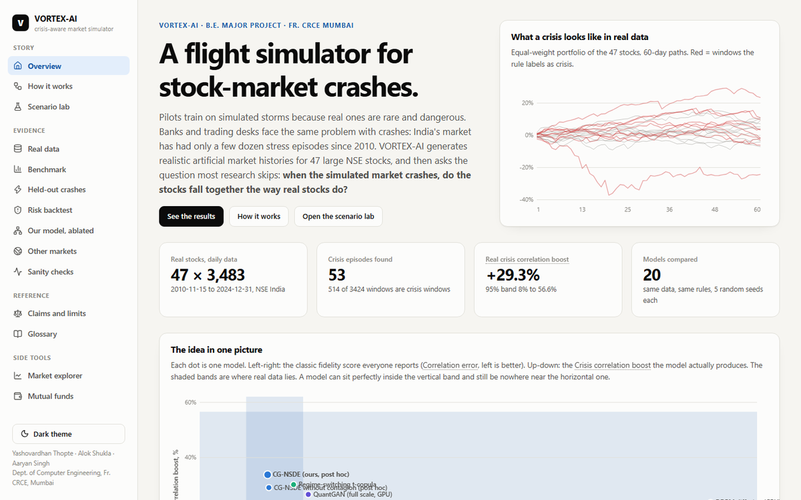
  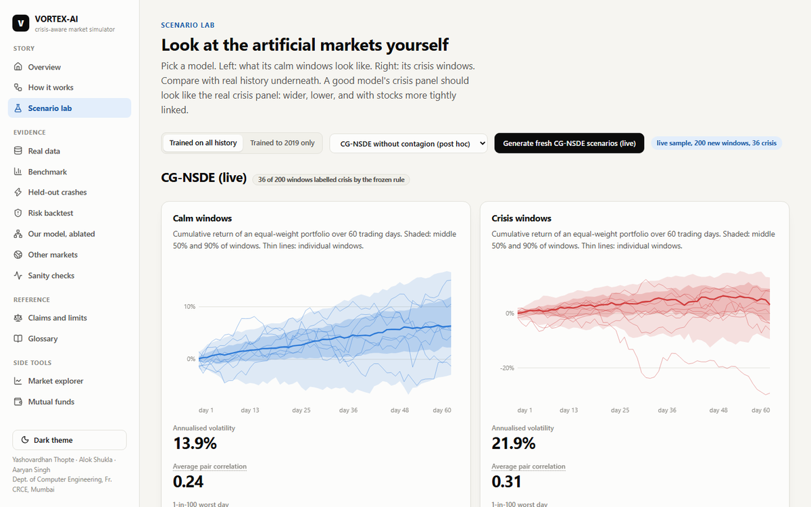
  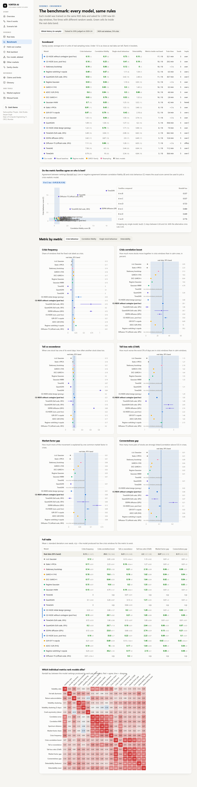
  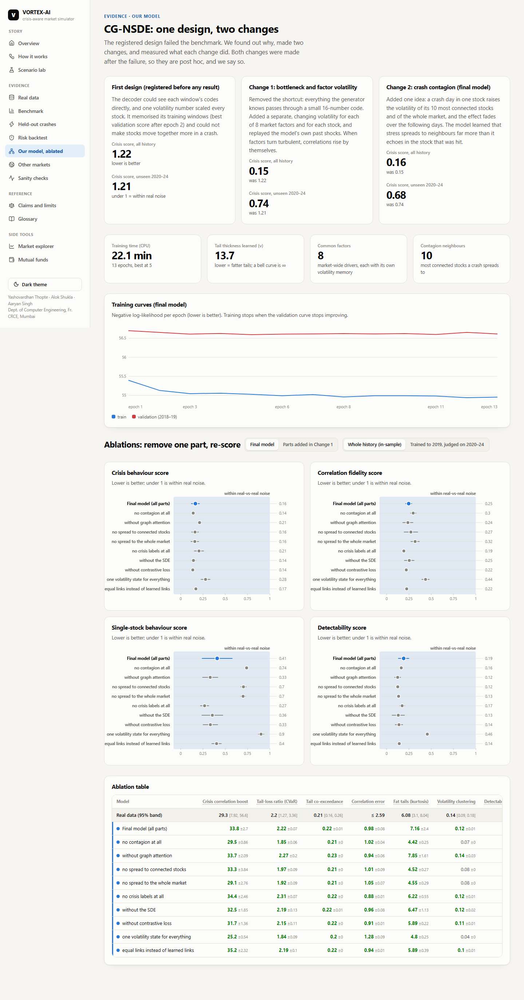
</p>

<p align="center"><a href="https://yash0238.github.io/Vortex-AI/"><b>▶ Open it live: yash0238.github.io/Vortex-AI</b></a></p>

- **How it works:** the benchmark explained step by step.
- **Benchmark:** every generator on every family, with a switch between *whole history* and *trained to 2019,
  judged on 2020–24*.
- **Our model:** the design path, training curves, the learned contagion graph and every ablation.
- **Crisis replay, Markets and Risk:** unseen crises, US and Korea replication, and the VaR/ES backtest.
- **Honest results:** all frozen hypotheses and verdicts, including the failures.
- **Scenario lab:** generate fresh markets from the trained model live.
- **Mutual funds and Market explorer:** live Indian fund NAVs and stock quotes.

---

## Architecture and deployment

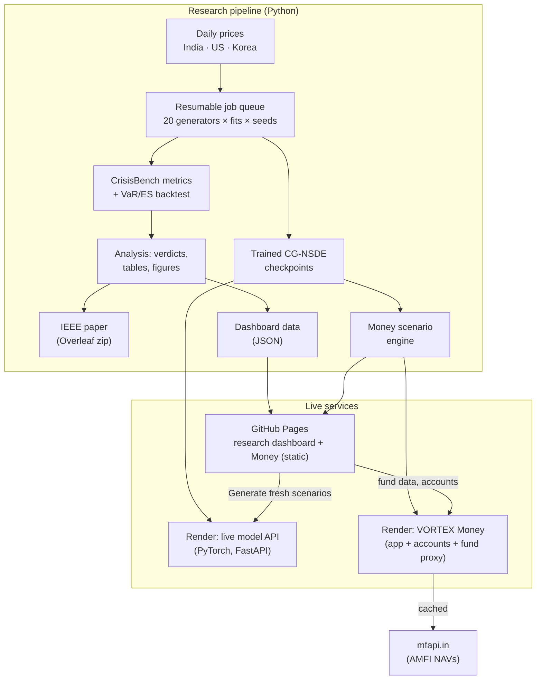

| Service | Where | Notes |
| --- | --- | --- |
| Research dashboard and Money (static) | GitHub Pages, branch `gh-pages` | Built with `VITE_BASE=/Vortex-AI/` plus the server URLs below. |
| Live model API | Render (free, Singapore), branch `deploy`, folder `api/` | Needs only model weights and two crisis-rule thresholds (`api/rules/`), never raw prices. |
| VORTEX Money | Render (free, Singapore), branch `deploy`, folder `money/` | One container for the app and its API. Free tier: accounts reset on restart. |

---

## Run it on your laptop

**Requirements:** Python 3.12, Node 22, Windows/macOS/Linux. A GPU is not needed: every CG-NSDE run takes about 20–30
minutes on a laptop CPU.

```bash
git clone https://github.com/yash0238/Vortex-AI.git && cd Vortex-AI
python -m venv .venv && .venv/Scripts/activate      # macOS/Linux: source .venv/bin/activate
pip install -r requirements.txt
cd app && npm install && npx vite build && cd ..
```

| Start | Windows | macOS / Linux | Opens |
| --- | --- | --- | --- |
| Research dashboard + live API | `start_dashboard.bat` | `uvicorn api.server:app --port 8000` and `cd app && npx vite preview --port 4173` | http://127.0.0.1:4173 |
| VORTEX Money (app + backend) | `start_money.bat` | `uvicorn money_api.app:app --port 8100` | http://127.0.0.1:8100 |
| VORTEX Money in Docker | `docker build -f Dockerfile.money -t vortex-money .` then `docker run -p 8100:8100 vortex-money` | same | http://127.0.0.1:8100 |

On a fresh clone VORTEX Money needs its scenario file:
`python -m crisisbench.export_money --gen cgnsde3` writes `app/public/money/engine.json`.

Tests (58): `python -m pytest tests`

---

## Reproduce every number

```bash
python -m crisisbench.data --market nse          # download and clean a panel (also: us, kr, nse_ext)
python -m crisisbench.queue --list               # what is done and what is left
python -m crisisbench.queue --stage all --workers 5 --threads 2    # all runs; resumable (or run_experiments.bat)
python -m crisisbench.analysis                   # tables, rank agreement, gates, hypothesis verdicts
python -m crisisbench.run_risk                   # VaR/ES backtest
python -m crisisbench.export_web                 # refresh the dashboard data
python -m crisisbench.paper_build                # figures, LaTeX tables, numbers.tex, Overleaf zip
python -m crisisbench.step0                      # the contagion pre-study on the French 49 industries
```

Full-scale GPU baselines (TimeGAN, QuantGAN, DDPM, Diffusion-TS) run on a free cloud GPU with
`cloud/vortex_fullscale.ipynb` and `cloud/vortex_diffusion_rerun.ipynb` (`python cloud/make_bundle.py` packs the inputs).

---

## Repository map

| Path | What is inside |
| --- | --- |
| `crisisbench/` | Frozen protocol, data pipeline, crisis rule, metrics, runner, job queue, analysis, risk backtest, exports, paper build |
| `crisisbench/generators/` | All generators. Ours: `cgnsde.py` (first design, registered), `cgnsde2.py` (Change 1), `cgnsde3.py` (final model with contagion) |
| `api/` | Live model API (`server.py`) and the market-data routes used by the Market explorer |
| `money_api/` | VORTEX Money backend |
| `app/` | React + TypeScript front ends: `index.html` (research dashboard), `money.html` (VORTEX Money) |
| `results/` | Per-run metrics, tables, verdicts (`results/tables/hypotheses.json`), contagion pre-study |
| `paper/` | IEEE paper source, references, generated figures, tables and numbers, Overleaf zip |
| `docs/` | `STATE.md` (project log), `step0_prereg.md`, `brand.md`, `screenshots/`, `archive/` |
| `cloud/` | Notebooks for the GPU baselines |
| `tests/` | 58 tests: generators, risk backtest, ground-truth simulator, Money backend |
| `models/`, `training/`, `eval/`, `baselines/`, root `*.py` | The earlier pipeline (kept for history; partly used by the Market explorer routes) |

---

## Limitations and responsible use

- **Few crises.** Fourteen years of data contain only a handful of independent crises, so intervals are wide and
  close rankings should not be over-read.
- **Post hoc model.** Both changes to CG-NSDE were made after the registered design failed. They are excluded from
  every preregistered verdict and need confirmation on future crises.
- **Data.** Free Yahoo Finance data for today's large stocks, so there is survivorship bias. Raw prices are not
  redistributed.
- **Not advice.** The models, scenarios and VORTEX Money are research and educational tools, not validated for
  investment or regulatory decisions.

---

## Team, paper and licence

| | |
| --- | --- |
| **Team** | Yashovardhan Thopte · Alok Shukla · Aaryan Singh |
| **Institution** | Department of Computer Engineering, Fr. Conceicao Rodrigues College of Engineering, Bandra (W), Mumbai |
| **Paper** | *Evaluating Crisis Dependence in Synthetic Equity Returns: A Preregistered Benchmark and a Graph-Contagion Neural SDE* (`paper/main.tex`, Overleaf zip in `paper/`) |
| **Licence** | MIT (see `LICENSE`) |

<div align="center">

*If a fake market cannot crash like a real one, it cannot teach anyone what a crash costs. VORTEX-AI is our attempt to make it crash properly, and to be honest about where it still falls short.*

</div>
